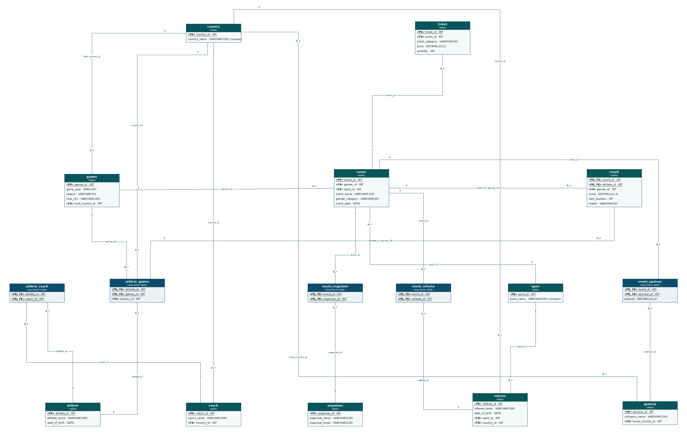

# Olympics Database: UML-to-Table Mapping

This repository documents the relational design of an Olympics database. The diagram maps the UML class model to **16 tables** with **21 foreign-key relations**. It covers countries, sports, Games editions, athletes, coaches, referees, events, results, sponsors, organizers and tickets.

The diagram source is [`database-Mapping.drawio`](database-Mapping.drawio). Every picture below is rendered directly from that file, so the table positions, columns and connector routes match the diagram. In the relation pictures, the involved tables and the connector are highlighted in orange, the key columns are shaded, and the rest of the diagram is faded.

## Full diagram

*Click the image to open it at full size.*

### How to read it

- `«PK»` is a primary key (underlined), and `«FK»` is a foreign key.
- `«table»` is a normal table, and `«association table»` is a join table that resolves a many-to-many relation.
- The numbers on a connector are the cardinality. `1` means exactly one, `0..1` means optional, and `0..*` means zero or more. The number next to the **parent** table comes first.
- The text in the middle of a connector is the foreign-key column (or columns).

## Tables at a glance

| Table | Kind | Primary key | Foreign keys (→ referenced table) |
|---|---|---|---|
| `country` | table | `country_id` | — |
| `sport` | table | `sport_id` | — |
| `games` | table | `games_id` | `host_country_id` → country |
| `athlete` | table | `athlete_id` | — |
| `athlete_games` | association table | `athlete_id`, `games_id` | `country_id` → country `games_id` → games `athlete_id` → athlete |
| `coach` | table | `coach_id` | `country_id` → country |
| `athlete_coach` | association table | `athlete_id`, `coach_id` | `athlete_id` → athlete `coach_id` → coach |
| `referee` | table | `referee_id` | `country_id` → country `sport_id` → sport |
| `event` | table | `event_id` | `sport_id` → sport `games_id` → games |
| `result` | table | `event_id`, `athlete_id` | `(event_id, games_id)` → event `(athlete_id, games_id)` → athlete_games |
| `event_referee` | association table | `event_id`, `referee_id` | `event_id` → event `referee_id` → referee |
| `sponsor` | table | `sponsor_id` | `home_country_id` → country |
| `event_sponsor` | association table | `event_id`, `sponsor_id` | `event_id` → event `sponsor_id` → sponsor |
| `organizer` | table | `organizer_id` | — |
| `event_organizer` | association table | `event_id`, `organizer_id` | `event_id` → event `organizer_id` → organizer |
| `ticket` | table | `ticket_id` | `event_id` → event |

## All 21 relations

| # | Parent table | Child table | Foreign key | Cardinality (parent : child) | Picture |
|---|---|---|---|---|---|
| 1 | `country` | `games` | `host_country_id` | 1 : 0..* | [picture](images/relation-01-country-games.png) |
| 2 | `country` | `coach` | `country_id` | 1 : 0..* | [picture](images/relation-02-country-coach.png) |
| 3 | `country` | `referee` | `country_id` | 1 : 0..* | [picture](images/relation-03-country-referee.png) |
| 4 | `country` | `sponsor` | `home_country_id` | 0..1 : 0..* | [picture](images/relation-04-country-sponsor.png) |
| 5 | `country` | `athlete_games` | `country_id` | 1 : 0..* | [picture](images/relation-05-country-athlete_games.png) |
| 6 | `sport` | `referee` | `sport_id` | 1 : 0..* | [picture](images/relation-06-sport-referee.png) |
| 7 | `sport` | `event` | `sport_id` | 1 : 0..* | [picture](images/relation-07-sport-event.png) |
| 8 | `games` | `event` | `games_id` | 1 : 0..* | [picture](images/relation-08-games-event.png) |
| 9 | `games` | `athlete_games` | `games_id` | 1 : 0..* | [picture](images/relation-09-athlete-games.png) |
| 10 | `athlete` | `athlete_games` | `athlete_id` | 1 : 0..* | [picture](images/relation-09-athlete-games.png) |
| 11 | `athlete` | `athlete_coach` | `athlete_id` | 1 : 0..* | [picture](images/relation-10-athlete-coach.png) |
| 12 | `coach` | `athlete_coach` | `coach_id` | 1 : 0..* | [picture](images/relation-10-athlete-coach.png) |
| 13 | `event` | `result` | `(event_id, games_id)` | 1 : 0..* | [picture](images/relation-11-event-result.png) |
| 14 | `athlete_games` | `result` | `(athlete_id, games_id)` | 1 : 0..* | [picture](images/relation-12-athlete_games-result.png) |
| 15 | `event` | `event_referee` | `event_id` | 1 : 0..* | [picture](images/relation-13-event-referee.png) |
| 16 | `referee` | `event_referee` | `referee_id` | 1 : 0..* | [picture](images/relation-13-event-referee.png) |
| 17 | `event` | `event_sponsor` | `event_id` | 1 : 0..* | [picture](images/relation-14-event-sponsor.png) |
| 18 | `sponsor` | `event_sponsor` | `sponsor_id` | 1 : 0..* | [picture](images/relation-14-event-sponsor.png) |
| 19 | `event` | `event_organizer` | `event_id` | 1 : 0..* | [picture](images/relation-15-event-organizer.png) |
| 20 | `organizer` | `event_organizer` | `organizer_id` | 1 : 0..* | [picture](images/relation-15-event-organizer.png) |
| 21 | `event` | `ticket` | `event_id` | 1 : 0..* | [picture](images/relation-16-event-ticket.png) |

## The relations in detail

Relations 9 and 10, 11 and 12, 15 and 16, 17 and 18, and 19 and 20 in the table above are the two halves of one many-to-many link, so each pair is shown in one picture. That gives 16 pictures for the 21 relations.

### 1. `country` → `games`  (host country)

**1 : 0..\*** via `games.host_country_id` → `country.country_id`

Every Games edition (year, season, host city) is hosted by exactly one country. One country can host many editions.

### 2. `country` → `coach`

**1 : 0..\*** via `coach.country_id` → `country.country_id`

Every coach belongs to one country. A country can have many coaches.

### 3. `country` → `referee`

**1 : 0..\*** via `referee.country_id` → `country.country_id`

Every referee belongs to one country. A country can have many referees.

### 4. `country` → `sponsor`  (home country)

**0..1 : 0..\*** via `sponsor.home_country_id` → `country.country_id`

This is the only *optional* relation in the diagram: a sponsor has **zero or one** home country (the FK can be `NULL`). A country can have many sponsors.

### 5. `country` → `athlete_games`  (country represented)

**1 : 0..\*** via `athlete_games.country_id` → `country.country_id`

The country an athlete competes for is stored on the athlete's *participation* row, not on the athlete. So the same athlete can represent a different country at a different Games.

### 6. `sport` → `referee`

**1 : 0..\*** via `referee.sport_id` → `sport.sport_id`

Every referee is assigned to one sport. A sport can have many referees.

### 7. `sport` → `event`

**1 : 0..\*** via `event.sport_id` → `sport.sport_id`

Every event belongs to one sport (for example a 100 m final belongs to athletics). A sport has many events.

### 8. `games` → `event`

**1 : 0..\*** via `event.games_id` → `games.games_id`

Every event is held at one Games edition. A Games edition contains many events.

### 9. `athlete` ↔ `games`  (many-to-many via `athlete_games`)

Two **1 : 0..\*** relations:

- `athlete_games.athlete_id` → `athlete.athlete_id`
- `athlete_games.games_id` → `games.games_id`

An athlete can take part in many Games, and a Games edition has many athletes. The association table `athlete_games` resolves this. Its primary key is the pair `(athlete_id, games_id)`, so an athlete can enter a given Games only once. It also carries `country_id` (see `country` → `athlete_games` above).

### 10. `athlete` ↔ `coach`  (many-to-many via `athlete_coach`)

Two **1 : 0..\*** relations:

- `athlete_coach.athlete_id` → `athlete.athlete_id`
- `athlete_coach.coach_id` → `coach.coach_id`

An athlete can have several coaches, and a coach can train several athletes. The primary key is `(athlete_id, coach_id)`.

### 11. `event` → `result`

**1 : 0..\*** via the composite key `(event_id, games_id)` → `event`

A result row belongs to exactly one event. One event has many results (one per athlete). Because the FK includes `games_id`, a result is always tied to the same Games as its event.

### 12. `athlete_games` → `result`

**1 : 0..\*** via the composite key `(athlete_id, games_id)` → `athlete_games`

A result can only exist for an athlete who is registered at that Games (a row in `athlete_games`). Together with `event` → `result` above, `result` links an athlete to an event and stores `score`, `rank_position` and `medal`. Its primary key is `(event_id, athlete_id)`, so an athlete has at most one result per event.

### 13. `event` ↔ `referee`  (many-to-many via `event_referee`)

Two **1 : 0..\*** relations:

- `event_referee.event_id` → `event.event_id`
- `event_referee.referee_id` → `referee.referee_id`

An event has several referees, and a referee can officiate several events. The primary key is `(event_id, referee_id)`.

### 14. `event` ↔ `sponsor`  (many-to-many via `event_sponsor`)

Two **1 : 0..\*** relations:

- `event_sponsor.event_id` → `event.event_id`
- `event_sponsor.sponsor_id` → `sponsor.sponsor_id`

An event can have several sponsors, and a sponsor can back several events. The association table also stores the `amount` (`DECIMAL(12,2)`) for each event/sponsor pair. The primary key is `(event_id, sponsor_id)`.

### 15. `event` ↔ `organizer`  (many-to-many via `event_organizer`)

Two **1 : 0..\*** relations:

- `event_organizer.event_id` → `event.event_id`
- `event_organizer.organizer_id` → `organizer.organizer_id`

An event can have several organizers, and an organizer can run several events. The primary key is `(event_id, organizer_id)`.

### 16. `event` → `ticket`

**1 : 0..\*** via `ticket.event_id` → `event.event_id`

Every ticket row (category, price, quantity) belongs to one event. An event can have many ticket categories.

## How the pieces fit together

- **Games** is the central time/place table. It has events, and athletes enter it through `athlete_games`.
- **Event** is the hub for everything that happens at a Games: results, tickets, referees, sponsors and organizers.
- **Result** connects an athlete's Games participation to an event, and only valid combinations can exist because of the composite keys.
- **Country** is referenced from five places: the host of a Games, a coach's country, a referee's country, a sponsor's optional home country, and the country an athlete represents.

## Editing the diagram

Open [`database-Mapping.drawio`](database-Mapping.drawio) in [diagrams.net](https://app.diagrams.net) (or the VS Code *Draw.io Integration* extension). If you change the diagram, re-export the pictures and update the images in `images/`.
